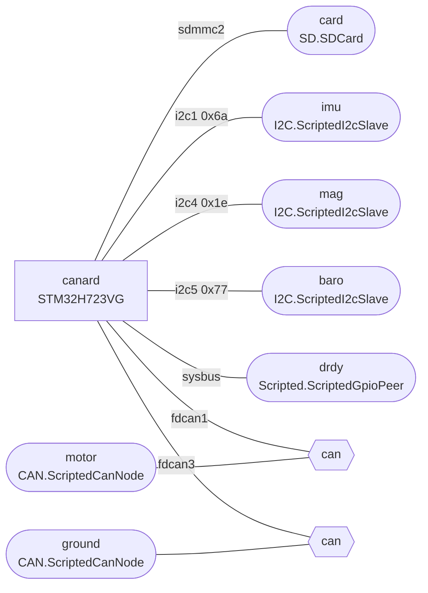
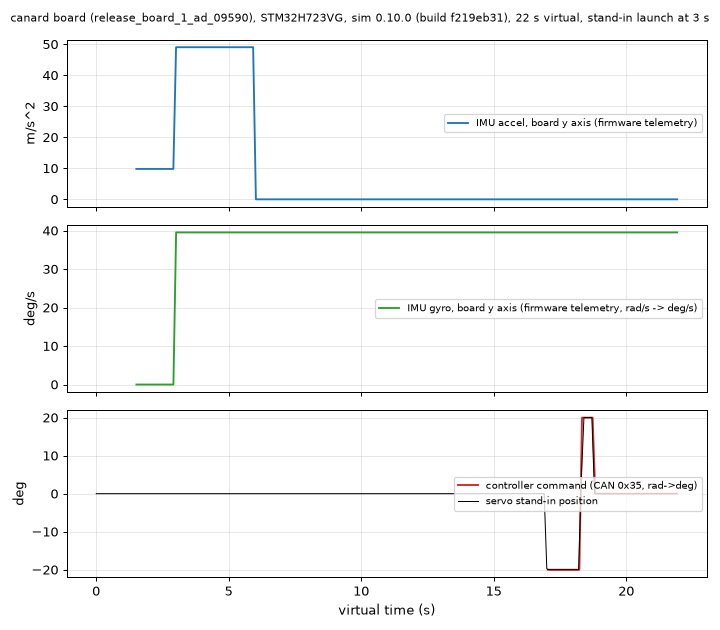
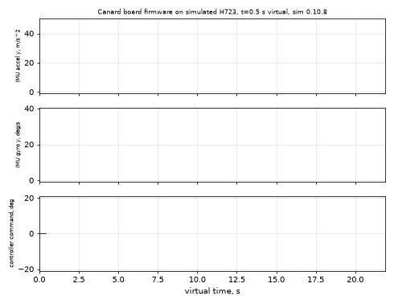

<!-- simantic-banner -->
> **Run this firmware with no hardware.** [Simantic](https://simantic.com) simulates the whole board, peripherals, sensors and buses included. Try it free at **[simantic.com](https://simantic.com)**, or run it locally: `curl -fsSL https://simantic.com/install | sh`

> **[Simantic](https://simantic.com)** runs this firmware on simulated hardware, no board needed. Try it at [simantic.com](https://simantic.com).

## This fork: the canard board in a simulator

Simantic's fork of Waterloo Rocketry's canard board firmware, with a `sim/` directory that runs the **unmodified production image** (`release_board_1_ad_09590`, STM32H723, FreeRTOS) in the Simantic simulator. Based on upstream `main` at `939ccecf`. Nothing here is offered to or published at upstream; only `sim/` and this section are added.
**Licence:** the repository is GPL-3.0 (`LICENSE.md`); the files under `sim/` are added under the same licence.

**What runs** (`sim` 0.10.0 build f219eb31, 2026-11-16, 22 s of virtual time, 65 s of wall time):

| Part | Model | Result |
| --- | --- | --- |
| Canard board | STM32H723VG, 4 MHz HSE as in the `.ioc` | boots, FreeRTOS tasks run, FDCAN3 broadcasts health and telemetry frames |
| LSM6DSV32X IMU (I2C1), MS5611 baro (I2C5), IIS2MDC mag (I2C4) | Python peers in `sim/peers/` | IMU and baro modules stop reporting errors; the firmware's accel and gyro telemetry follow the peer's profile |
| AK45 servo (FDCAN1) | Python peer, fixed slew rate | receives the firmware's position commands (4602 by 22 s), answers with feedback |
| Ground node (FDCAN3) | Python peer | logs every frame; sends the pad-filter and ignition commands at 1.5 s and 2.0 s |
| SD card (SDMMC2) | blank 64 MB card | boot proceeds; the logger cannot write (no filesystem, see gaps) |

**Scenario** (`sim graph --scenario sim/scenario.yaml`):



**Run data** (`sim/screenshots/signals.png`, drawn by `sim/plot.py` from the run's own `can3.csv` and `servo.csv`; canard board, `release_board_1_ad_09590`, sim 0.10.0 build f219eb31, 22 s virtual). The IMU peer plays a stand-in profile: 1 g on the pad, 5 g for 3 s from t=3 s, then 40 deg/s roll. The top two panels are what the firmware itself reported over CAN; the bottom panel is the controller's command angle (CAN) and the servo peer's position.





*Same run re-measured on `sim` 0.10.8 (build 64f89c38), 2026-11-25, 22 s of virtual time, 115 s of wall time on a loaded laptop (about 5 s per virtual second). Drawn from `sim/out/can3.csv` and `servo.csv` by `sim/make_gif.py`.*

The GIF shows the flight-phase FSM (`fsm_state_t`): IDLE, PAD_FILTER 1.501 s, PAD_NAV 2.001 s, BOOST 3.011 s (launch-accel event), ACT_ALLOWED 10.011 s (7 s actuation delay). No CAN frame carries the state, so it is read from the arguments of `flight_phase_update_state` with `--trace-symbol` (see the header of `sim/make_gif.py` for the command). 10 firmware modules report severity ERROR on 0x18 for the whole run (no peer models their hardware, e.g. ADXL380, SD card, Movella); that is a model gap, not a finding about the firmware.

What the plot shows: the IMU readings arrive in the firmware's telemetry on the board's y axis (the driver remaps axes); the controller commands the servo only from 16.955 s to 18.74 s, first -20 deg then +20 deg, and 0 otherwise. Why it commands that, and whether its estimator is meaningful with no Movella unit attached, is `unverified`.

**Configurations tried:**

| Configuration | Virtual | Wall | Result |
| --- | --- | --- | --- |
| Bare ELF, no board file | 12 s | 0.3 s | stops in `Error_Handler` (PC 0x0800b362) after the SDMMC2 init (no card present); no CAN, no UART output |
| + blank SD card, 4 MHz HSE, no CAN medium | 3 s | 0.8 s | runs past init; nothing observable without a bus |
| + servo and ground CAN peers, no sensor peers | 12 s | 21.5 s | 559 frames on FDCAN3; every module reports severity ERROR |
| + IMU, baro, mag peers, data-ready strobes, ground commands | 22 s | 65 s | IMU and baro modules clear; telemetry follows the profile; controller commands 16.955 s to 18.74 s |

**Gaps, with the evidence** (health frames, message type 0x18, severity 1 = error, on FDCAN3 in a 14 s run; causes not investigated, `unverified`):
- Movella (module 0x0D, bitfield 0x00000040), ADXL380 (0x01) and ADXRS649 (0x02): no peers for the Movella UART or the AD breakout board.
- AK45 (0x03, 0x00004000) reports an error although the servo peer answers.
- IIS2MDC (0x0A, 0x01010000) stays in error with the mag peer attached; not investigated.
- SD card (0x11) and logger (0x0B): the blank card has no filesystem, so no logs are written.
- Power handler (0x10, 0x00000007): no rail monitor peers.
- Only the fixed stand-in profile is exercised: no physics, no noise. The firmware's own bench or flight logs were not replayed.

**Run it** (needs `sim`, PlatformIO, Python 3.12+):

```sh
sim/build.sh                  # builds release_board_1_ad_09590, copies the ELF to sim/build/
sim/run.sh 22                 # 22 s virtual; writes sim/out/can3.csv, servo.csv, sim.log
python3 sim/plot.py "title"   # optional, needs matplotlib
```

**Changes to the firmware:** none.

Everything below is Waterloo Rocketry's README.

---

# Canard Board Firmware

Firmware for 2025-27 Canard Board, performing state estimation and control for the 2nd & 3rd iteration of the canards system. Project documentation can be found in the team Google Drive.
In 2024-25, this project was firmware for Processor Board in the first canards system

## Project Structure

- `src/drivers/`: custom peripheral driver modules
- `src/application/`: high-level application logic modules
- `src/third_party/`: third-party libraries, including CubeMX auto-gen files, `closedrocket` source files, and MATLAB codegen 
- `src/common/`: shared resources specific to this project
- `tests/`: everything for [testing](#Unit-Testing)

## Developer Setup

### 1. Clone repo

- Clone repo and initialize submodules: ` git clone --recurse-submodules https://github.com/waterloo-rocketry/cansw_canards`

### 2. Firmware dev in PlatformIO: edit, build, flash, debug

All firmware dev is done in VSCode using PlatformIO (previously using devcontainer) for easy cross-platform usage.

- Install the PlatformIO extension in VSCode and open this folder
- PlatformIO should auto-detect this project by recognizing the `platformio.ini` file
- Use the PlatformIO tab to Build and Upload. Ex, `Project Tasks > General > Build`
- Use the "Run and Debug" tab to debug on the board once connected via ST-Link
- If needed, switch between debug/release environments: `Ctrl+Shift+P > PlatformIO: Pick Project Environment`
- Auto-format the project code: `Project Tasks > Custom > Format`

### 2.1 STM32CubeMX

Steps to configure stuff in CubeMX and auto-generate code:

- Open `cansw_canard_board_h733.ioc` and `cansw_canard_board_h723.ioc` in CubeMX and configure things as needed
- Click `Generate Code` and wait for the pop-up that indicates it's done
- Run the script `./scripts/cubemx_cleanup.sh` to make the auto-gen files conform to our project setup
- Run clang-format (see section 2) to format the auto-gen code

### 3. Run unit tests in devcontainer

The devcontainer has everything installed to run unit tests using CMake. One could also install all the dependencies locally if desired but the devcontainer is recommended to avoid "but it works on my machine!" issues.

Devcontainer setup:

- [Install devcontainers](https://code.visualstudio.com/docs/devcontainers/tutorial)
- In a new vscode window, use `Ctrl+Shift+P`, search `Dev Containers: Open Folder In Container...`, then select this project folder
    - The first time opening the project will take several minutes to build the devcontainer. Subsequent times will be instant.

Run tests:

- Open the CMake plugin tab from the sidebar
- Under `Configure`, select which build type you want
- Hover over `Build`, click the build icon to build the configuration
    - The build preset should automatically be selected (eg, `Build Firmware (Debug) preset`)

### 4. Build HIL
- Switch to the HIL build environment: `Ctrl+Shift+P > PlatformIO: Pick Project Environment > env:hil`
- Build and upload as usual. Now the board will be in HIL mode


## Unit Testing

We use GoogleTest and [Fake Function Framework (fff)](https://android.googlesource.com/platform/external/fff/+/cacd5f5459dba658e0c88ceff32282a0e9fab0a5/README.md) for unit testing. All testing-related files are in `tests/`.

- Tests are built from `tests/CMakeLists.txt` which is separate from the project's main build config. Building and running tests is done via cmake.
- Test source code should be written in `tests/unit/`.
- Mocks should be made with fff in `tests/mocks/`.

### Add a test

- Add a new test group file in `tests/unit/`. See `test_dummy.cpp` for example of test structure.
- Add the test group to the cmake build system by editing `tests/CMakeLists.txt`:
    - At the bottom of the file, add the new test group using the `add_test_group()` helper.
      (Read the comments + existing examples explaining how it works)

### Add a mock

We do not include the STM32 HAL library nor FreeRTOS when compiling the project for unit tests.
So if a source file uses a HAL or FreeRTOS file, those files and their functions must be mocked using fff.
This also lets us mock any module that a test interacts with but doesn't test.

Example 1:

- `src/drivers/gpio/gpio.c` uses FreeRTOS semaphores via `#include "semphr.h`.
    - In the actual firmware, the real `semphr.h` is included when compiling. But for unit tests, the real `semphr.h` is not included when compiling. So, the unit tests fail to compile (it can't find a `semphr.h` file).
        - To correct this we add a "fake" `semphr.h` in `tests/mocks/semphr.h`. All files in this folder are included when compiling unit test, so the tests now compile.
    - The gpio code uses functions from the real `semphr.h` like `xSemaphoreTake()`. These don't exist in our fake `semphr.h` yet.
        - To correct this we need to create a mock `xSemaphoreTake()` function using fff.
          [fff's Readme](https://github.com/meekrosoft/fff?tab=readme-ov-file#hello-fake-world) describes how to create fake functions. Here's the mock for `xSemaphoreTake()`:

            ```
            // The func to mock: BaseType_t xSemaphoreTake(SemaphoreHandle_t arg0, TickType_t arg1)

            DECLARE_FAKE_VALUE_FUNC(BaseType_t, xSemaphoreTake, SemaphoreHandle_t, TickType_t);
            ```

            First we put the _declaration_ (`DECLARE_FAKE...`) in `mocks/semphr.h`. Then, put the actual _definition_ (`DEFINE_FAKE...`) in the corresponding `mocks/semphr.c`.

- Now in the gpio tests, we can access the mocked semaphore functions via fff to test that the gpio code uses semaphores correctly.

Example 2:

- `src/application/estimator/estimator.c` takes input from flightphase via `#include "application/flight_phase/flight_phase.h`.
    - To test estimator, we will test various inputs from flightphase. But we don't want to be testing flightphase at the same time.
      So, mock flightphase.
    - The real `flight_phase.h` header is built in unit tests, but the source file `flight_phase.c` is not.
        - Since a function _declaration_ for `get_flight_phase()` exists in the header, we can use fff's `DEFINE_FAKE...` to create a
          fake _definition_ of that `get_flight_phase()`. That definition should be in the test .cpp file, or in the mocks folder if it's applicable for wider use.
        - (Note: unlike example 1 where the header isn't included in unit tests, the flightphase header is included so it doesnt need a `DECLARE_FAKE...`)

### Run/debug tests

- Build in vscode using cmake (see step 3 above)
    - The default `Build Unit Tests With Coverage preset` also automatically runs all tests and generates coverage report.
    - View the coverage report html pages in `build/test/coverage_report` in a local browser
- Use the vscode cmake `Launch` and `Debug` tabs to run/debug individual test groups (cmake shows the available test groups)

## Code Standards

This project follows the [team-wide embedded coding standard](https://docs.waterloorocketry.com/general/standards/embedded-coding-standard.html).

- Use the `Format` target via PlatformIO to format via clang-format (see step 2)

- Rocketlib is included at `src/third_party/rocketlib`.
- Developers should be aware of the BARR Standard and make an effort to follow it.

## Adding Log Messages

When adding a new type of data log message, all of the following should be updated:

- src/application/logger/log.h
    - Add a new enum value to `log_data_type_t`:
        ```diff
         typedef enum {
        +    LOG_TYPE_XXX = M(unique_small_integer),
         } log_data_type_t;
        ```
    - Add a struct definition of your message's data fields to `log_data_container_t`:
        ```diff
         typedef union __attribute__((packed)) {
        +    struct __attribute__((packed)) {
        +        uint32_t l;
        +        float f;
        +        // ...
        +    } typename;
         } log_data_container_t;
        ```
- scripts/logparse.py
    - Add a new format spec to the `FORMATS` dict:
        ```diff
         FORMATS = {
        +    M(unique_small_integer): Spec(name, format, [field, ...]),
         }
        ```
